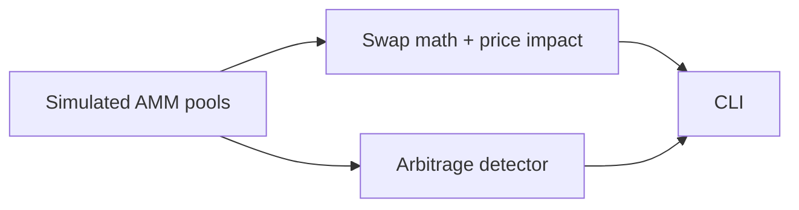

<p align="center">
  
</p>

<h1 align="center">Solana Trading Bot</h1>

<p align="center">
  <strong>Solana DEX trading bot — constant-product AMM math, slippage control, and cross-pool arbitrage in Python.</strong><br>
  Model Raydium/Orca-style pools, quote swaps with price impact, and find arbitrage between pools.
</p>

<p align="center">
  <em>Built and maintained by <a href="https://viprasol.com">Viprasol Tech</a> — Fintech Experts. Full-Stack Builders.</em>
</p>

<p align="center">
  <a href="https://github.com/Viprasol-Tech/solana-trading-bot/actions/workflows/ci.yml"></a>
  <a href="LICENSE"></a>
  
  <a href="https://t.me/viprasol_help"></a>
  <a href="https://github.com/Viprasol-Tech/solana-trading-bot/stargazers"></a>
</p>

---

> ## ⚠️ Disclaimer
> This software is for **educational purposes only** and is **not financial advice**. On-chain and DEX trading involves substantial risk, including the **total loss of capital**, MEV, and smart-contract risk. The pools here are **simulated** for learning. Always test thoroughly and comply with all applicable laws. **Use at your own risk** — Viprasol Tech assumes no responsibility for your trading results.

---

## ✨ Features

- 🌊 **Constant-product AMM** — the `x · y = k` model behind Raydium/Orca pools.
- 📉 **Slippage & price impact** — quote swaps and compute minimum-received for a tolerance.
- 🔁 **Cross-pool arbitrage** — detect and size buy-cheap / sell-dear opportunities across pools.
- 🧮 **Verifiable math** — invariant-preserving swaps, fully unit-tested.
- 🖥️ **CLI** — `solana-trading-bot swap` and `solana-trading-bot arb`.
- ⚙️ **Modern tooling** — ruff, mypy (strict), pytest, GitHub Actions CI.

## 🚀 Quickstart

```bash
git clone https://github.com/Viprasol-Tech/solana-trading-bot.git
cd solana-trading-bot
python -m pip install -e ".[dev]"

solana-trading-bot swap --amount 10 --slippage-bps 50
solana-trading-bot arb --quote-in 1000
```

## 🧩 Use the AMM directly

```python
from solana_trading_bot.amm import ConstantProductPool

pool = ConstantProductPool(base=1_000, quote=150_000, fee_bps=30)  # ~150 USDC/SOL
out = pool.amount_out(10, base_to_quote=True)        # USDC out for 10 SOL
impact = pool.price_impact(10, base_to_quote=True)   # fractional price impact
```

## 🏗️ Architecture



## 🗺️ Roadmap

- [x] Constant-product AMM + slippage + arbitrage detector
- [ ] Live Solana RPC + Jupiter/Raydium quotes
- [ ] Wallet signing & transaction submission
- [ ] Token sniping with safety checks

## 🤝 Contributing

PRs welcome — see [CONTRIBUTING.md](CONTRIBUTING.md) and our [Code of Conduct](CODE_OF_CONDUCT.md).

## 📬 Contact — Viprasol Tech Private Limited

- 🌐 Website: [viprasol.com](https://viprasol.com)
- ✉️ Email: [support@viprasol.com](mailto:support@viprasol.com)
- 💬 Telegram: [t.me/viprasol_help](https://t.me/viprasol_help) · 📱 WhatsApp: +91 96336 52112
- 🐙 GitHub: [@Viprasol-Tech](https://github.com/Viprasol-Tech) · 💼 [LinkedIn](https://www.linkedin.com/in/viprasol/) · 𝕏 [@viprasol](https://twitter.com/viprasol)

> *Viprasol Tech — fintech software, algorithmic trading systems, MT4/MT5 bots, AI voice agents, and B2B SaaS. Need a custom build? [Get in touch](mailto:support@viprasol.com).*

## 📄 License

[MIT](LICENSE) © 2025 Viprasol Tech Private Limited
