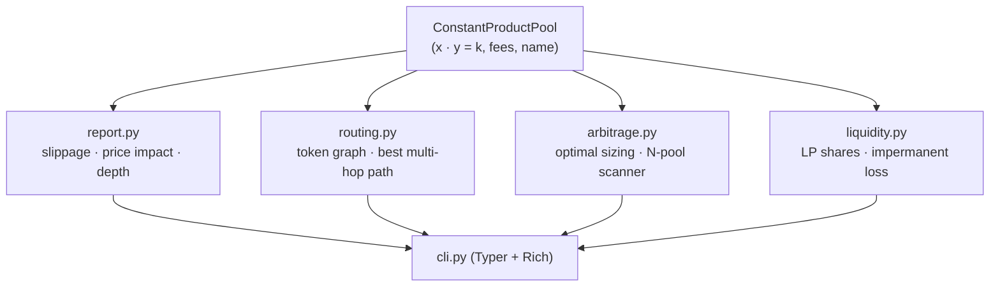

<p align="center">
  
</p>

<h1 align="center">Solana Trading Bot</h1>

<p align="center">
  <strong>A Solana DEX toolkit in Python — constant-product AMM math, multi-hop routing, slippage &amp; price-impact reports, N-pool arbitrage scanning, and LP analytics.</strong><br>
  Model Raydium/Orca-style pools, route trades across a token graph, scan for arbitrage, and quantify impermanent loss.
</p>

<p align="center">
  <em>Built and maintained by <a href="https://viprasol.com">Viprasol Tech</a> — Fintech Experts. Full-Stack Builders.</em>
</p>

<p align="center">
  <a href="https://github.com/Viprasol-Tech/solana-trading-bot/actions/workflows/ci.yml"></a>
  <a href="LICENSE"></a>
  
  
  
  
  <a href="https://t.me/viprasol_help"></a>
  <a href="https://github.com/Viprasol-Tech/solana-trading-bot/stargazers"></a>
</p>

---

> ## ⚠️ Disclaimer
> This software is for **educational purposes only** and is **not financial advice**. On-chain and DEX trading involves substantial risk, including the **total loss of capital**, MEV, sandwich attacks, and smart-contract risk. The pools and prices here are **simulated** for learning — there is no RPC, wallet, or live execution. Nothing here is a recommendation to trade. Always do your own research, test thoroughly, and comply with all applicable laws. **Use at your own risk** — Viprasol Tech assumes no responsibility for your trading results.

---

## ✨ Features

- 🌊 **Constant-product AMM** — the `x · y = k` model behind Raydium/Orca, with swap math, exact-output inversion, and invariant-preserving execution.
- 📉 **Slippage & price-impact reports** — executed price, impact in bps, fee paid, min-received, a full **depth curve**, and the max trade size under an impact cap.
- 🧭 **Multi-hop routing** — model pools as a token graph and find the best path by output (e.g. `SOL → USDC → BONK`), with a per-hop breakdown.
- 🔁 **N-pool arbitrage scanner** — scan every pair across many same-pair pools, **optimally sized** with a closed-form profit-maximising input, sorted by profit & ROI.
- 💧 **LP / position analytics** — add/remove liquidity, pool share, and **impermanent-loss** vs HODL for any price move.
- 🖥️ **Rich CLI** — `swap`, `depth`, `route`, `scan`, `arb`, `lp`, `version` with formatted tables.
- 🧪 **Verifiable & typed** — 54 unit tests, `mypy --strict`, `ruff`, `py.typed`, and CI.

## 🚀 Quickstart

```bash
git clone https://github.com/Viprasol-Tech/solana-trading-bot.git
cd solana-trading-bot
python -m pip install -e ".[dev]"

solana-trading-bot swap  --amount 25 --slippage-bps 50   # slippage report
solana-trading-bot route --amount 5                       # best multi-hop route
solana-trading-bot scan                                   # arbitrage across pools
solana-trading-bot lp    --base-amount 10 --exit-price 300  # impermanent loss
```

Or run the end-to-end example:

```bash
PYTHONPATH=src python examples/quickstart.py
```

## 🧩 Usage

```python
from solana_trading_bot.amm import ConstantProductPool
from solana_trading_bot.report import build_swap_report, max_size_for_impact
from solana_trading_bot.arbitrage import scan_pools
from solana_trading_bot.liquidity import add_liquidity, position_pnl
from solana_trading_bot.routing import Router

# 1) Quote a swap with a full slippage / price-impact report.
pool = ConstantProductPool(base=1_000, quote=150_000, fee_bps=30, name="raydium")
rep = build_swap_report(pool, amount_in=25, slippage_bps=50)
print(rep.amount_out, rep.price_impact_bps, rep.min_received)

# 2) Largest trade that keeps price impact under 1%.
print(max_size_for_impact(pool, max_impact=0.01))

# 3) Multi-hop routing across a token graph.
router = (
    Router()
    .add_pool(ConstantProductPool(1_000, 150_000, name="SOL/USDC"), "SOL", "USDC")
    .add_pool(ConstantProductPool(2e9, 50_000, name="BONK/USDC"), "BONK", "USDC")
)
best = router.best_route("SOL", "BONK", amount_in=5, max_hops=3)
print(best.path, best.amount_out)  # ('SOL', 'USDC', 'BONK') ...

# 4) Optimally-sized arbitrage across N same-pair pools.
pools = [
    ConstantProductPool(1_000, 149_000, name="meteora"),
    ConstantProductPool(1_000, 153_000, name="orca"),
    ConstantProductPool(1_000, 150_000, name="raydium"),
]
for op in scan_pools(pools):
    print(op.buy_pool, "->", op.sell_pool, op.profit, op.roi)

# 5) LP impermanent loss vs HODL for a 2x move.
pos = add_liquidity(pool, base_amount=10, total_shares=1_000)
print(position_pnl(pos, exit_price=300)["il_fraction"])  # ~ -0.0572
```

## 🏗️ Architecture



## 📚 API at a glance

| Module | Key API | What it does |
| --- | --- | --- |
| `amm` | `ConstantProductPool`, `amount_out`, `amount_in_for_out`, `price_impact`, `optimal_arbitrage_size` | Core AMM swap math and invariant |
| `report` | `build_swap_report`, `depth_curve`, `max_size_for_impact` | Slippage / price-impact reporting |
| `routing` | `Router`, `find_routes`, `best_route`, `Route` | Multi-hop routing across a token graph |
| `arbitrage` | `find_arbitrage`, `optimal_arbitrage`, `scan_pools` | Cross-pool & N-pool arbitrage |
| `liquidity` | `add_liquidity`, `remove_liquidity`, `position_pnl`, `impermanent_loss` | LP position analytics |
| `cli` | `swap` · `depth` · `route` · `scan` · `arb` · `lp` | Command-line interface |

## 🗺️ Roadmap

- [x] Constant-product AMM + slippage / price-impact reports
- [x] Multi-hop routing across a token graph
- [x] N-pool arbitrage scanner with closed-form optimal sizing
- [x] LP position helpers + impermanent loss
- [ ] Live Solana RPC + Jupiter/Raydium quotes
- [ ] Concentrated-liquidity (CLMM) pool model
- [ ] Wallet signing & transaction submission
- [ ] Token sniping with safety checks

## ❓ FAQ

**Is this connected to mainnet?** No. All pools and prices are simulated so every command runs offline with zero risk. Live RPC is on the roadmap.

**What pool model is used?** Constant-product (`x · y = k`), the model behind Raydium AMM v4 and Orca's classic pools. Concentrated liquidity (CLMM) is planned.

**How is the arbitrage size chosen?** `scan_pools` defaults to a **closed-form profit-maximising input** for each pool pair (you can also pass a fixed `quote_in`).

**Why does the LP "lose" money in the demo?** That is **impermanent loss** — for a 2x price move an LP underperforms simply holding by ~5.72%, before fees. The library quantifies it for you.

## 🤝 Contributing

PRs welcome — see [CONTRIBUTING.md](CONTRIBUTING.md) and our [Code of Conduct](CODE_OF_CONDUCT.md). Before opening a PR:

```bash
ruff check . && ruff format . && mypy src && PYTHONPATH=src python -m pytest -q
```

## Contact — Viprasol Tech Private Limited

- Website: [viprasol.com](https://viprasol.com)
- Email: [support@viprasol.com](mailto:support@viprasol.com)
- Telegram: [t.me/viprasol_help](https://t.me/viprasol_help) | WhatsApp: +91 96336 52112
- GitHub: [@Viprasol-Tech](https://github.com/Viprasol-Tech) | [LinkedIn](https://www.linkedin.com/in/viprasol/) | X [@viprasol](https://twitter.com/viprasol)

## License

[MIT](LICENSE) (c) 2025 Viprasol Tech Private Limited
